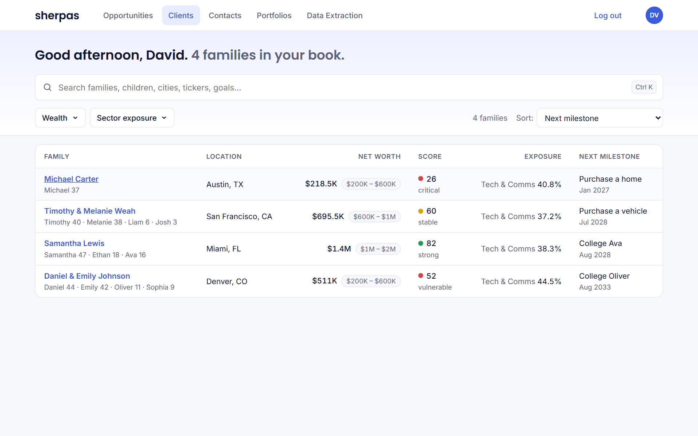
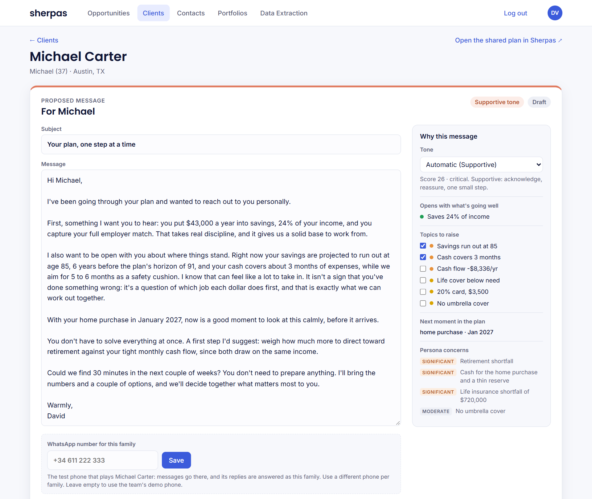

<p align="center">
  
</p>

# First to know, first to tell

**An advisor console and an AI advisor on WhatsApp that keep 150 families close, each one in their own terms.**

Sherpas challenge, CDTM Valencia Hacks 2026. Challenge brief: [`docs/challenge-brief.md`](docs/challenge-brief.md).

---

## The problem

An advisor looks after around 150 families, and each one wants to feel like the only one. After the plan is delivered:

- **Families hear it from the news first.** A market drop or a tax change, and nobody tells them what it means for *them*.
- **Smaller families feel like a number.** "We have $150,000, but it is our $150,000."
- **The advisor can't personalise at scale.** Watching everything for everyone and writing 30 personal messages a day, each one approved, takes the whole morning.

## Our solution

1. **See the whole book at a glance.** A Clients view of every family: search by name, child, city, ticker or goal; filter by wealth and sector exposure. *"Tech fell 30%, who do I call first?"* is one click, ranked by each family's own exposure.
2. **A personal message, ready to approve.** Each family's page opens with a proposed message written from *their* plan. The tone follows their situation: supportive when things are hard, steady when there is bad news under a good score, celebratory when all is well. Each message has its reasons, the family's real figures and one small next step. The advisor edits, rewrites it with AI or approves it in seconds.
3. **Sent on WhatsApp, followed by an AI advisor.** One click sends the approved message. When the family replies, an AI "senior advisor" answers in their language with their own numbers. It follows strict rules: calm first, no judgment, a traffic light for purchases, the right protocol for market drops and tax changes, and never an invented figure.
4. **Voice notes, answered by voice (optional).** With `BOT_VOICE_NOTES=1`, when a family sends a WhatsApp voice note, the voice API transcribes it and checks whether their case data can answer it. If it can, they get a spoken answer back as a voice note. If it needs outside news or the advisor, the AI advisor replies in text instead. By default the bot answers text only, and ignores stickers, photos, videos and audio.

<p align="center">
  
  
</p>

## What it looks like for a family

Daniel & Emily: score 52, 1.1 months of cash after near-term goals, a credit card at 24.9%. They write on WhatsApp. The reply below is from our tests, shortened:

> **Daniel & Emily:** I want to buy my son Oliver a PS5 for his birthday
>
> **Advisor (AI):** That's a lovely idea for Oliver — I can hear how much you want him to have a special birthday.
>
> Right now your accessible cash covers *1.1 months* of essential expenses after near-term goals, and you carry a card at *24.9%* (about $374 a month in interest). With that thin cushion, buying a PS5 today would reduce your family's margin for unexpected events.
>
> So you can sleep soundly: I don't think this is the right time. *I'm noting this in your follow-up right now.* As soon as we've rebuilt the cushion and made progress on the card, I'll let you know personally so you can buy it without worry.

Every figure comes from their plan. When markets fall, the same advisor opens with calm and cites *their* worst fall and recovery: "10%, recovered in 61 days". When the IRS publishes the 2027 values, it says "$200 more a year for Oliver and Sophia" and cites IRS IR-2026-133.

## Demo in 60 seconds

1. **Book:** "This is David's book." It holds the 4 case families here; a real advisor has about 150. Filter *Sector exposure: Tech* and the list re-ranks by exposure.
2. **Family:** open Michael Carter (score 26, critical). The message is already written: it starts with what he does well and is honest about the gaps, without blame.
3. **Approve and send:** click *Send via WhatsApp*; the message arrives on the phone playing Michael.
4. **Reply:** from that phone, ask *"¿Puedo comprarme un coche de 40.000 dólares?"* The AI advisor answers in Spanish, red light, with his real cushion and his January 2027 home purchase.

## How it works

```
 Any device (browser)                One machine (e.g. a laptop)                       Outside
 ┌────────────────────┐   tunnel   ┌───────────────────────────────────────────┐
 │ Web app            │ ─────────▶ │ Server  apps/api   (password, keys)        │ ──▶ AI proxy (gpt-5-mini)
 │ (React)            │   https    │   serves the web app + /api                │
 └────────────────────┘            │        │ approved message (localhost only) │
                                   │        ▼                                   │
                                   │ WhatsApp bot  apps/whatsapp-bot            │ ──▶ WhatsApp ──▶ family's test phone
                                   │   sends, and answers replies with the AI   │ ◀──            (replies, voice notes)
                                   │        │ voice note (localhost only)       │
                                   │        ▼                                   │
                                   │ Voice API  apps/voice-api                  │ ──▶ AI proxy (scribe-v2, gpt-5-mini,
                                   │   transcribe, answer from the case, speak  │     eleven-flash-v2.5) + MCP cases
                                   └───────────────────────────────────────────┘
 Data: cases/ (the four families' plans, personas, investments, legal values, signals)
```

- **Grounded:** messages and replies are built only from the case files in [`cases/`](cases/). The AI gets a compact fact sheet of about 4k tokens with the exact figures, never raw guesses.
- **The advisor decides:** proposed messages are drafts until approved. The AI advisor's rules are in [`apps/whatsapp-bot/prompts/advisor-system.md`](apps/whatsapp-bot/prompts/advisor-system.md). The team's full master prompt is in [`docs/advisor-master-prompt.md`](docs/advisor-master-prompt.md).
- **Safe by default:** keys live only on the server, the app is password-protected, and the bot's outbox never leaves the machine.

## Run it

Needs Node 22.6 or later.

```bash
cp .env.example .env   # TEAM_KEY and LLM_PROXY_URL (password defaults to 1234)
npm run setup          # once
npm run serve          # builds the web app, starts the server and the WhatsApp bot
```

The bot answers text messages only; it ignores stickers, photos, videos and audio. To answer voice notes, set `BOT_VOICE_NOTES=1` in `.env`: `npm run serve` then also starts the voice API. It needs FFmpeg with the Opus encoder (`ffmpeg -encoders` must list `libopus`) and `MCP_TOKEN`.

1. Scan the QR code in the terminal with the bot's WhatsApp (Settings, Linked devices).
2. Publish the app: `cloudflared tunnel --url http://127.0.0.1:8787`, then open the `https://….trycloudflare.com` address on any device and log in with `APP_PASSWORD`. The demo password is `1234` by default, and the login page shows it. Set `APP_PASSWORD` to change it, or `SHOW_PASSWORD_ON_LOGIN=0` to hide it.
3. On each family's page, set **"WhatsApp number for this family"**: one test phone per family. Messages go there, and its replies are answered as that family.

`npm run api:check` checks every connection: keys, AI proxy, MCP server, server and bot. For local development, run `npm run api` and `npm run web` separately. Details are in each app's README: [`apps/web`](apps/web), [`apps/api`](apps/api), [`apps/whatsapp-bot`](apps/whatsapp-bot).

## What it uses

| | |
|---|---|
| Web app | React 18, TypeScript, Vite, plain CSS |
| Server | Node 22, no framework, no dependencies |
| WhatsApp | [Baileys](https://github.com/WhiskeySockets/Baileys) (WhatsApp Web protocol) |
| AI | `gpt-5-mini` through the hackathon AI proxy, low reasoning effort (about 10 s per reply) |
| Voice | `scribe-v2` (speech to text), `gpt-5-mini`, `eleven-flash-v2.5` (text to speech), FFmpeg; case data through the MCP |
| Data | The four Sherpas cases in [`cases/`](cases/); legal values and signals included |

## Repository
```
apps/web            advisor web app (Clients view, family pages, proposed messages)
apps/api            server: web app + API, password, AI rewrite, WhatsApp hand-off
apps/whatsapp-bot   WhatsApp bot: sends approved messages, AI advisor replies
apps/voice-api      voice notes: transcribe, answer from the case, reply by voice
cases/ legal/       the challenge data (unchanged)
docs/               challenge brief, master prompt, specs, screenshots
scripts/serve.mjs   runs everything on one machine
```
